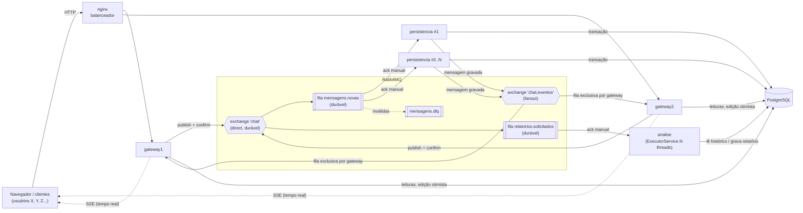
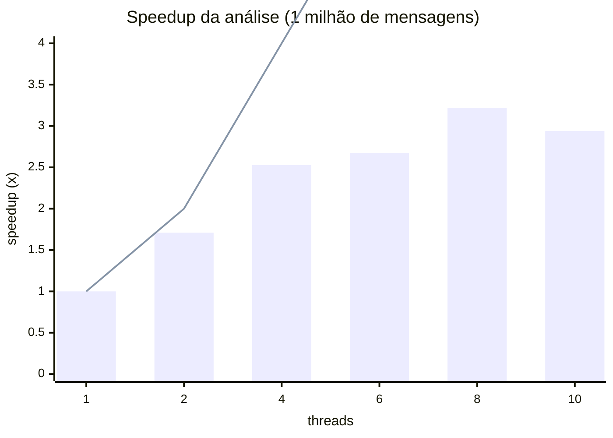

# Threads — chat distribuído (Entrega 2)

**Equipe:** Arthur Xavier, Caio Melo, Gabriel Assef da Nova, Ranilton

## Origem do projeto: o trabalho da equipe na Parte 1

Este sistema é a evolução direta do protótipo que a equipe construiu na Parte 1: um chat "estilo Discord" em Java, em que três usuários (`X`, `Y` e `Z`), cada um na sua thread, mandam mensagens para um `Canal` que protege o histórico com `synchronized`. O código original está em [`parte1-original/`](parte1-original/).

A Parte 1 deixou definidas as decisões que sustentam a Entrega 2:
- **as entidades do domínio:** Usuário, Canal, Mensagem e ChatService;
- **a separação entre quem envia e quem armazena:** `ChatService` × `Canal`;
- **o problema central de concorrência:** vários usuários escrevendo ao mesmo tempo no mesmo canal, e a ordem do histórico precisa continuar correta.

A Entrega 2 leva essas mesmas ideias para o ambiente distribuído. A seção [5. Consistência](#5-consistência) e o [relatório de IA](docs/RELATORIO_IA.md) mostram a correspondência ponto a ponto.

Na Parte 2, o mesmo domínio (Usuário, Canal, Mensagem, ChatService) virou um **sistema distribuído** com 8 containers:
- **comunicação assíncrona** via RabbitMQ;
- **paralelismo** no relatório de moderação;
- **consistência forte** na ordem e na edição das mensagens;
- **tolerância a falhas** demonstrada com kill de serviços.

| Documento | Conteúdo |
|---|---|
| este README | relatório técnico (itens 1 a 6 do enunciado) |
| [docs/RELATORIO_IA.md](docs/RELATORIO_IA.md) | relatório de uso de IA (prompts, sugestões aceitas/rejeitadas) |
| [docs/ROTEIRO_APRESENTACAO.md](docs/ROTEIRO_APRESENTACAO.md) | roteiro da demo ao vivo e perguntas prováveis |
| [resultados/](resultados/) | saídas brutas dos benchmarks e logs das demos de falha |

---

## Como executar

Pré-requisito: Docker Desktop (ou Docker Engine + Compose v2). Não é preciso ter Java nem Maven: a compilação acontece dentro do Docker.

```bash
docker compose up -d --build
```

| Endereço | O quê |
|---|---|
| http://localhost:8080 | interface do chat (criar canais, enviar, editar, rajada X/Y/Z, relatório paralelo, painel de consistência) |
| http://localhost:15672 | painel do RabbitMQ (guest / guest) |
| `localhost:5433` | Postgres (threads / threads) |

Scripts de demonstração e medição:

```bash
docker compose run --rm ferramentas seed historico 500000   # popula o canal "historico" para o relatório pesado
scripts/demo-consistencia.sh                                # item 5
scripts/demo-falha.sh todos                                 # item 6 (ou: consumidor | gateway | banco | broker)
scripts/benchmark.sh                                        # itens 3 e 4 (~10 min)
```

Exemplos com `curl`:

```bash
curl -X POST localhost:8080/api/canais/geral/mensagens -H 'Content-Type: application/json' -d '{"usuario":"X","texto":"Bom dia"}'
curl localhost:8080/api/canais/geral/mensagens
curl localhost:8080/api/stats
```

Para desligar: `docker compose down` (mantém os dados) ou `docker compose down -v` (apaga tudo).

---

## 1. Arquitetura distribuída



### Por que cada serviço existe separado

| Serviço | Responsabilidade | Por que separado | Réplicas |
|---|---|---|---|
| **nginx** | balanceia entre gateways e faz failover | ponto de entrada único; se um gateway cair, a requisição vai para o outro | 1 |
| **gateway** (`GatewayServer`) | API HTTP e página web; **produtor**: publica mensagens e pedidos de relatório; lê o histórico; edição com controle otimista; empurra eventos via SSE | sem estado e ligado a rede. Precisa responder rápido e não pode depender do banco estar rápido. Por não ter estado, dá para ter 2 e matar 1 | 2 |
| **persistencia** (`PersistenciaWorker`) | **consumidor**: grava mensagens no Postgres com número de sequência por canal | ligado a I/O de banco. Escala horizontalmente (`--scale`), e se morrer a fila guarda o trabalho | 2 (até 4 no benchmark) |
| **analise** (`AnaliseWorker`) | consome pedidos de relatório e roda a análise **paralela** | ligado a CPU e demorado. Junto com a persistência, um relatório atrasaria o chat | 1 |
| **RabbitMQ** | desacopla produtores e consumidores; guarda mensagens em disco | infraestrutura | 1 |
| **PostgreSQL** | fonte da verdade: mensagens, canais, relatórios | infraestrutura | 1 |

**O que não separamos, e por quê:** não criamos um serviço para Usuário nem para Canal. Seriam microsserviços "por entidade", sem carga própria e com muitas chamadas entre si. O critério de separação foi **perfil de carga e de falha** (rede × banco × CPU), não o modelo de dados.

Todos os serviços Java são **o mesmo `.jar`** com papéis diferentes (variável `ROLE`; veja [`App.java`](src/main/java/threads/App.java)). Isso simplifica o build, e cada container continua sendo um processo independente.

### Fluxo de uma mensagem (a `Main` da Parte 1, agora distribuída)

1. O cliente faz `POST /api/canais/geral/mensagens`. O gateway gera um `id` (UUID), publica a mensagem no exchange `chat`, **espera o confirm** do broker e responde **202 Accepted**.
2. Uma das réplicas de persistência recebe a mensagem e, numa transação, faz `UPDATE canais ... RETURNING ultimo_seq` (lock da linha do canal) e depois `INSERT ... ON CONFLICT (id) DO NOTHING`. Só depois do COMMIT ela envia o **ack**.
3. A persistência publica um evento no fanout `chat.eventos`. Os dois gateways recebem o evento e o empurram via SSE para os navegadores conectados.

---

## 2. Comunicação assíncrona e garantia de entrega

O broker é o **RabbitMQ 3.13**. A topologia está em [`Rabbit.java`](src/main/java/threads/comum/Rabbit.java).

| Risco de perda | Mecanismo | Onde no código |
|---|---|---|
| Gateway responde OK e o broker perde a mensagem | **Publisher confirms**: `confirmSelect()` + `waitForConfirmsOrDie(5s)`. Se não confirmar, o gateway devolve 503 e o cliente reenvia | `GatewayServer.publicarComConfirmacao` |
| Broker reinicia | **Exchanges e filas duráveis** + **mensagens persistentes** (`deliveryMode=2`) | `Rabbit.declararTopologia`, `Rabbit.PERSISTENTE` |
| Consumidor morre no meio do processamento | **Ack manual** (`autoAck=false`), enviado só depois do COMMIT. Mensagem sem ack volta para a fila e vai para outra réplica | `PersistenciaWorker.Consumidor.handleDelivery` |
| Reentrega causa duplicata | **Consumo idempotente**: `id` gerado no gateway é PK, e `ON CONFLICT (id) DO NOTHING` + rollback | `PersistenciaWorker.gravar` |
| Cliente reenvia após timeout | Cabeçalho **`Idempotency-Key`**: mesma chave gera o mesmo `id` (UUID v3) | `GatewayServer.enviarMensagem` |
| Banco fora do ar | **Retry com backoff exponencial** (200 ms → 5 s, 8 tentativas) e depois `basicNack(requeue=true)`. A mensagem nunca é descartada | `PersistenciaWorker` |
| Mensagem malformada (veneno) | `basicReject(requeue=false)` → **Dead Letter Queue** `mensagens.dlq` (não some, fica para inspeção) | `x-dead-letter-exchange` |
| Excesso de mensagens em memória no consumidor | `basicQos(prefetch=20)`: no máximo 20 sem ack por consumidor | `PersistenciaWorker` |
| Conexão com o broker cai | `AutomaticRecovery` + `TopologyRecovery` do cliente AMQP + heartbeat de 10 s | `Rabbit.conectar` |

A semântica é **at-least-once** na entrega e **exactly-once no efeito** (graças à idempotência).

---

## 3. Paralelismo com ganho

**Tarefa:** o relatório de moderação e engajamento de um canal ([`AnalisadorMensagens.java`](src/main/java/threads/analise/AnalisadorMensagens.java)). Para cada mensagem do histórico:
1. normaliza o texto (minúsculas e remoção de acentos via Unicode NFD);
2. separa as palavras e conta a frequência (sem stopwords);
3. **modera:** sinaliza a mensagem se tiver palavra proibida;
4. pontua o **sentimento** com um léxico de palavras positivas e negativas;
5. calcula o **SHA-256** do texto para detectar spam repetido;
6. conta mensagens por usuário.

**Por que dá para paralelizar:** cada mensagem é independente das outras.

**Trecho paralelo:** `AnalisadorMensagens.analisarParalelo(msgs, nThreads)`.

```java
ExecutorService pool = Executors.newFixedThreadPool(nThreads);
// MAP: um Callable por bloco contíguo da lista
for (int inicio = 0; inicio < n; inicio += tamanhoBloco)
    futuros.add(pool.submit(() -> processarBloco(msgs, ini, fim)));
// REDUCE: Future.get() (o join() da Parte 1) + juntar resultados parciais
for (Future<Parcial> f : futuros) total.juntar(f.get());
```

Cada thread escreve só no **seu** objeto `Parcial`. Não há memória compartilhada durante o processamento, então não precisa de `synchronized` (ao contrário da Parte 1). A versão sequencial (`analisarSequencial`) roda o mesmo `processarBloco` sobre a lista inteira. O benchmark confere que **as duas dão exatamente o mesmo resultado**.

Os números estão na seção 4.

---

## 4. Avaliação de desempenho

### Metodologia

| | Benchmark 1: análise (CPU) | Benchmark 2: pipeline ponta a ponta | Benchmark 3: relatório real |
|---|---|---|---|
| **O que mede** | tempo da análise sequencial × paralela (1, 2, 4, 6, 8 e 10 threads) | vazão de aceite, vazão ponta a ponta (até gravar no banco) e latência p50/p95/p99 do POST | tempo de carregar 500 mil mensagens do banco + análise sequencial × paralela, via fila |
| **Como** | `System.nanoTime()` em [`BenchAnalise`](src/main/java/threads/bench/BenchAnalise.java), dados em memória (sem I/O) | [`BenchPipeline`](src/main/java/threads/bench/BenchPipeline.java): 64 clientes HTTP concorrentes → nginx → … → Postgres; consulta `/api/stats` até tudo estar gravado | pedidos `POST /relatorios`; o `AnaliseWorker` mede cada fase |
| **Volume** | 1.000.000 mensagens sintéticas (semente fixa 42; 6 a 30 palavras cada) | 5.000 mensagens por rodada, em 1 canal ou 8 canais; 1, 2 e 4 réplicas de persistência | 500.000 mensagens no canal `historico` |
| **Repetições** | 2 de aquecimento (JIT) descartadas + 5 medidas; média, desvio e mínimo | 1 de aquecimento + 3 medidas por configuração | 3 por nº de threads |
| **Ambiente** | MacBook (Apple M4, 10 núcleos: 4 de desempenho + 6 de eficiência), Docker Desktop com VM de 10 vCPUs e 7,75 GB; Java 21.0.13 (Temurin, Linux aarch64); Postgres 16; RabbitMQ 3.13. **Todos os 8 containers e o gerador de carga dividem a mesma máquina.** | mesmo | mesmo |

Para reproduzir: `scripts/benchmark.sh`. As saídas brutas ficam em [`resultados/`](resultados/).

### Resultados

#### Benchmark 1: análise sequencial × paralela (1 milhão de mensagens, só CPU)

| Threads | Tempo médio (ms) | Desvio (ms) | Mínimo (ms) | Speedup | Eficiência | Resultado = sequencial |
|---:|---:|---:|---:|---:|---:|:---:|
| 1 | 6512.1 | 154.3 | 6404.8 | 1.00x | 100.0% | sim |
| 2 | 3804.7 | 126.1 | 3708.1 | 1.71x | 85.6% | sim |
| 4 | 2575.0 | 99.8 | 2482.3 | 2.53x | 63.2% | sim |
| 6 | 2440.4 | 313.0 | 2173.9 | 2.67x | 44.5% | sim |
| 8 | 2019.9 | 100.4 | 1906.7 | 3.22x | 40.3% | sim |
| 10 | 2214.6 | 185.9 | 1972.0 | 2.94x | 29.4% | sim |


*(barras = speedup medido; linha = speedup ideal, limitado ao eixo)*

**Antes × depois:** 6,5 s sequencial → **2,0 s com 8 threads (3,2x mais rápido)**, e o resultado é idêntico ao sequencial em todas as execuções.

#### Benchmark 3: relatório real pelo serviço de análise (500 mil mensagens, banco + CPU)

| Threads | Carregar do banco (ms) | Análise sequencial (ms) | Análise paralela (ms) | Speedup da análise | Total paralelo (banco+CPU) | Total sequencial (banco+CPU) |
|---:|---:|---:|---:|---:|---:|---:|
| 1 | 586 | 3280 | 3130 | 1.05x | 3716 | 3866 |
| 2 | 457 | 3145 | 1577 | 1.99x | 2034 | 3602 |
| 4 | 443 | 3158 | 890 | 3.55x | 1333 | 3601 |
| 8 | 460 | 3160 | 672 | 4.70x | 1132 | 3620 |
| 10 | 499 | 3230 | 752 | 4.29x | 1252 | 3730 |

**Antes × depois do ponto de vista do usuário:** o relatório levava **3,6 s** e passou a levar **1,1 s** com 8 threads (3,2x). Só a parte de CPU ganhou **4,7x**.

#### Benchmark 2: pipeline ponta a ponta (5.000 mensagens, 64 clientes concorrentes)

| Configuração | Canais | Reps | Vazão aceite (msg/s) | Vazão ponta a ponta (msg/s) | Latência p50 (ms) | p95 (ms) | p99 (ms) | Erros |
|---|---:|---:|---:|---:|---:|---:|---:|---:|
| 1-replica(s) | 1 | 3 | 1601 | 888 | 34.7 | 75.4 | 142.6 | 0 |
| 1-replica(s) | 8 | 3 | 1590 | 1078 | 45.3 | 94.1 | 145.3 | 0 |
| 2-replica(s) | 1 | 3 | 1538 | 837 | 46.3 | 96.5 | 198.2 | 0 |
| 2-replica(s) | 8 | 3 | 1774 | 1198 | 31.4 | 67.4 | 130.5 | 0 |
| 4-replica(s) | 1 | 3 | 1163 | 717 | 67.3 | 172.3 | 273.6 | 0 |
| 4-replica(s) | 8 | 3 | 1576 | 1283 | 36.0 | 78.7 | 128.7 | 0 |

Os dados brutos de cada rodada estão em [`resultados/bench-pipeline.csv`](resultados/bench-pipeline.csv).

### Interpretação: onde está o gargalo?

**1. Paralelismo (benchmarks 1 e 3).**
- *O ganho é real, mas sublinear.* A eficiência cai de 86% (2 threads) para 40% (8 threads). Há três causas:
  - **(a) Alocação de memória:** cada mensagem gera várias `String` (normalização, `split`, SHA em hex). Com 8 threads alocando ao mesmo tempo, o coletor de lixo e a banda de memória viram o limite, não a CPU.
  - **(b) Núcleos heterogêneos:** o M4 tem 4 núcleos de desempenho e 6 de eficiência. Até 4 threads, quase todo o trabalho cai nos núcleos rápidos; depois disso, os blocos dos núcleos lentos atrasam o `Future.get()` final, porque o tempo total é o do bloco mais lento.
  - **(c) Concorrência pela máquina:** com **10 threads** o tempo **piora** (2,2 s contra 2,0 s com 8), porque a VM tem 10 vCPUs e precisa dividi-las também com o GC, o Postgres, o RabbitMQ e os outros containers. O melhor ponto foi 8 threads.
- *Lei de Amdahl na prática (benchmark 3).* Carregar 500 mil mensagens do Postgres leva cerca de 460 ms em **todas** as configurações: é uma parte sequencial (um cursor JDBC só). Na versão sequencial ela é 13% do tempo total; com 8 threads passa a ser **41%**. Com 8 threads a CPU deixou de ser o gargalo do relatório, e o próximo passo seria ler do banco em paralelo (por faixa de `seq`) ou manter estatísticas incrementais.
- O speedup da análise no benchmark 3 (4,7x) é maior que no benchmark 1 (3,2x) porque o volume é a metade (500 mil contra 1 milhão), o que reduz a pressão sobre o GC e a memória. Isso reforça a causa (a).

**2. Pipeline distribuído (benchmark 2).**
- *Vazão de aceite (cerca de 1.600 msg/s) contra vazão ponta a ponta (cerca de 900 a 1.300 msg/s).* O gateway aceita mais rápido do que o banco grava, e a diferença fica guardada na fila. **É o desacoplamento funcionando:** a fila absorve picos, e a latência do cliente (p50 de cerca de 35 ms) não depende do banco.
- *O gargalo ponta a ponta é a gravação no Postgres.* Cada mensagem é uma transação com `COMMIT` (fsync em disco) e um `UPDATE` na linha do canal.
- **Com 1 canal, adicionar réplicas não ajuda e até piora** (888 → 837 → 717 msg/s com 1, 2 e 4 réplicas). Todas as transações disputam o **mesmo lock de linha** (`canais.ultimo_seq`), então o trabalho é serializado por definição. Mais réplicas só significam mais transações esperando o lock, e o p99 sobe de 143 para 274 ms. **Esse é o custo direto da consistência forte da ordem**: escolhemos ordem correta em vez de vazão num canal único.
- **Com 8 canais, as réplicas escalam** (1.078 → 1.198 → 1.283 msg/s, +19%), porque os locks são de linhas diferentes e as transações rodam de fato em paralelo. O ganho é limitado porque o Postgres, o RabbitMQ, os gateways e o gerador de carga disputam os mesmos 10 núcleos da máquina.
- *Variância:* algumas rodadas isoladas foram 2 a 3 vezes mais lentas (ver o CSV, por exemplo 554 msg/s numa rodada com 4 réplicas). Isso é ruído de ambiente compartilhado (GC da JVM, checkpoint do Postgres, outros processos do notebook). Por isso reportamos a média de 3 rodadas após o aquecimento.
- *Melhorias possíveis, coerentes com o diagnóstico:*
  - agrupar várias mensagens por transação (*batch commit*), o que reduz os fsyncs;
  - `synchronous_commit=off`, trocando durabilidade de alguns milissegundos por vazão;
  - fazer o *publish* em lote com confirms assíncronos no gateway;
  - particionar canais por réplica, para evitar a disputa de lock.


---

## 5. Consistência

### Modelo escolhido

| Dado | Modelo | Justificativa |
|---|---|---|
| **Ordem das mensagens no canal** (`seq`) | **Forte** (serializável por canal) | Num chat, todos precisam ver a mesma ordem. Duas mensagens com o mesmo número ou um buraco seriam bugs visíveis. |
| **Edição de mensagem** | **Forte**, com controle de concorrência **otimista** (`versao`) | Edição perdida ("last write wins" silencioso) é inaceitável. Com o otimista, quem perde a corrida é avisado (409). |
| **Feed em tempo real (SSE)** e **relatórios** | **Eventual** | São visões derivadas. Se um evento SSE se perder, o histórico do banco continua correto, e o relatório reflete o momento em que foi gerado. |
| **Aceite da mensagem** (202) × gravação | **Eventual** (milissegundos) | É o preço do desacoplamento: depois do 202, a mensagem aparece no histórico logo em seguida, não instantaneamente. Em troca, o chat aceita mensagens mesmo com o banco fora. |

**Como a consistência forte é garantida com várias réplicas gravando ao mesmo tempo:** o Postgres é a única fonte da verdade. A linha do canal em `canais` funciona como o `synchronized` da Parte 1:

```sql
UPDATE canais SET ultimo_seq = ultimo_seq + 1 WHERE nome = ? RETURNING ultimo_seq;  -- trava a linha até o COMMIT
INSERT INTO mensagens (...) VALUES (...) ON CONFLICT (id) DO NOTHING;                  -- idempotente
```

Há ainda uma rede de segurança: `UNIQUE (canal, seq)` no esquema.

### Demonstração (`scripts/demo-consistencia.sh`)

Execução real:

```
==== Cenário A: 2000 mensagens disputando o MESMO canal ao mesmo tempo ====
>> Enviando 2000 mensagens com 50 clientes simultâneos para 1 único canal...
RESULTADO: enviadas=2000 gravadas=2000 erros_cliente=0 -> NENHUMA MENSAGEM PERDIDA
>> Verificação no banco: seq precisa ser exatamente 1..N, sem buraco e sem repetição
     canal      | mensagens | seqs_distintas | min | max  | replicas_que_gravaram
----------------+-----------+----------------+-----+------+-----------------------
 carga-8f145d-0 |      2000 |           2000 |   1 | 2000 |                     2
>> Distribuição do trabalho entre réplicas (mesmo canal, gravado por processos diferentes):
 processada_por | count
----------------+-------
 8dfec67ba03a   |   990
 e6cfcac3572a   |  1010

==== Cenário B: duas pessoas editando a MESMA mensagem ao mesmo tempo (conflito) ====
>> Mensagem 77ab7f8e-... criada (versao 1). Ana e Bruno leram a versao 1 e salvam ao mesmo tempo:
  Bruno -> HTTP 409
  Ana   -> HTTP 200
  resposta Bruno: {"versaoAtual":2,"erro":"conflito: a mensagem foi editada por outra pessoa","textoAtual":"versão da Ana"}
>> Estado final no banco (só UMA edição venceu; a outra recebeu 409 e não sobrescreveu):
 77ab7f8e-... | versão da Ana |      2
```

- **Cenário A:** 4 consumidores concorrentes (2 processos × 2 canais AMQP) gravaram 2000 mensagens no mesmo canal. O resultado foram 2000 números de sequência distintos, de 1 a 2000, sem buraco nem repetição, apesar de cada réplica gravar cerca de metade.
- **Cenário B:** duas edições simultâneas da mesma versão. Exatamente uma vence e a outra recebe **409 Conflict** com o texto atual. Nenhuma atualização foi perdida em silêncio.

A interface web também mostra a verificação ao vivo (painel "Consistência", que consulta `/api/stats`). Para testar o conflito na interface, edite a mesma mensagem em duas abas.

---

## 6. Tolerância a falhas

`scripts/demo-falha.sh` derruba de propósito quatro componentes durante a carga. O gerador de carga confere no fim se **enviadas = gravadas**. Os logs completos estão em [`resultados/logs/`](resultados/logs/) e [`resultados/logs-demo-falha.txt`](resultados/logs-demo-falha.txt).

| # | O que derrubamos | Como | Mecanismo que segurou | Resultado |
|---|---|---|---|---|
| 1 | Réplica de **persistência** no meio de 3000 mensagens (com 2327 na fila) | `docker kill` (SIGKILL) | ack manual: as mensagens sem ack voltam para a fila e a outra réplica assume; a reentrega é tratada pela idempotência; restart automático | **3000 enviadas = 3000 gravadas**, seq consistente |
| 2 | **Gateway1** durante 3000 POSTs | `docker kill` | nginx `proxy_next_upstream` (failover para o gateway2) + `Idempotency-Key` | **3000 = 3000**, **0 erros para o cliente** (o nginx registrou `Connection reset` e reenviou) |
| 3 | **Postgres** por 15 s durante 2000 mensagens | `docker compose stop postgres` | o gateway continua aceitando (HTTP 202, pois as mensagens ficam na fila); os workers fazem **retry com backoff** e **timeout** de 3 s no pool | **2000 = 2000** após o banco voltar |
| 4 | **RabbitMQ** reiniciado com 200 mensagens na fila (sem consumidores) | `docker compose restart rabbitmq` | fila durável + mensagem persistente; reconexão automática dos clientes | 200 na fila antes, **200 depois**, e as 200 gravadas |

Trechos dos logs da execução (completos em `resultados/logs-demo-falha.txt`):

```
==== Falha 1: matar (kill -9) uma réplica de PERSISTÊNCIA no meio da carga ====
    "filaPendentes": 2327,
>> docker kill threads-distribuido-persistencia-1  (SIGKILL: morre sem avisar ninguém)
>> Fila após a queda (a outra réplica continua consumindo; as mensagens sem ack voltaram para a fila):
    "filaPendentes": 1665,
    "filaConsumidores": 2,
RESULTADO: enviadas=3000 gravadas=3000 erros_cliente=0 -> NENHUMA MENSAGEM PERDIDA
persistencia-1  | 01:13:44.500 [INFO] persistencia - [3f7f58dc1cd8] pronto: 2 consumidores, prefetch=20, atraso=10ms

==== Falha 2: derrubar um GATEWAY durante a carga (failover no nginx) ====
nginx-1  | [error] recv() failed (104: Connection reset by peer) while reading response header from upstream ... upstream: "http://172.21.0.4:8080/..."
RESULTADO: enviadas=3000 gravadas=3000 erros_cliente=0 -> NENHUMA MENSAGEM PERDIDA

==== Falha 3: parar o POSTGRES por 15 s durante a carga ====
  POST com banco fora do ar -> HTTP 202
mensagens.novas	1679	80          <- 1679 esperando na fila, 80 em processamento (sem ack)
persistencia-1  | [WARN] Falha no banco (tentativa 4/8): Connection is not available, request timed out after 3001ms. Retry em 1600 ms
persistencia-1  | [WARN] Falha no banco (tentativa 5/8): Connection is not available, request timed out after 3000ms. Retry em 3200 ms
RESULTADO: enviadas=2000 gravadas=2000 erros_cliente=0 -> NENHUMA MENSAGEM PERDIDA

==== Falha 4: REINICIAR o RabbitMQ com mensagens na fila ====
mensagens.novas	200      (antes do restart)
mensagens.novas	200      (depois do restart)
 broker-1795396464 |   200   (gravadas após religar os consumidores)

==== Consistência geral após as falhas ====
    "totalMensagens": 10205,
    "consistente": true,
    "dlq": 0
```

**Sobre a reentrega na falha 1:** nesta execução, o `kill` não caiu exatamente entre o COMMIT e o ack, então nenhuma duplicata precisou ser descartada. Se cair, o log mostra `DUPLICADA ignorada id=...` e o total continua correto, por causa do `ON CONFLICT (id) DO NOTHING`.

### Limitações conhecidas

O RabbitMQ, o Postgres e o nginx rodam numa instância só e são pontos únicos de falha. A demonstração cobre a falha dos **serviços da aplicação** e a **durabilidade** do broker após restart. Em produção, usaríamos:
- RabbitMQ em cluster de 3 nós com *quorum queues*;
- Postgres com réplica síncrona e failover (Patroni);
- dois balanceadores com IP virtual.
